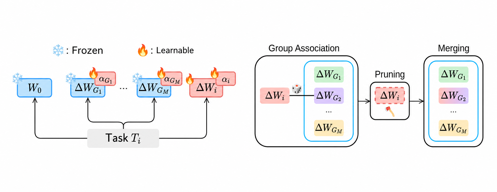

<h1 align="center">
  GLAM: Efficient Continual Learning at Scale via Grouped LoRA Adapter Merging
</h1>

<p align="center">
  <a href="https://arxiv.org/abs/2509.13211">
    
  </a>
  <a href="https://lifelong-ml.cc/">
    
  </a>
</p>

<p align="center">
  <a href="https://scholar.google.com/citations?hl=it&user=uDsnUzgAAAAJ">Irene Testa</a><sup>1</sup>,
  <a href="https://scholar.google.com/citations?user=TM5H03oAAAAJ&hl=it">Luigi Quarantiello</a><sup>1</sup>,
  <a href="https://scholar.google.com/citations?hl=it&user=326UIJYAAAAJ">Eric Nuertey Coleman</a><sup>1</sup>,
  <a href="https://scholar.google.com/citations?user=zHF9tloAAAAJ&hl=it&oi=ao">Samrat Mukherjee</a><sup>2</sup>,
  <a href="https://scholar.google.com/citations?user=ZKnSBs4AAAAJ&hl=it&oi=ao">Julio Hurtado</a><sup>3</sup>,
  <a href="https://www.vincenzolomonaco.com">Vincenzo Lomonaco</a><sup>4</sup>
</p>

<p align="center">
  <sup>1</sup>University of Pisa &nbsp;&middot;&nbsp;
  <sup>2</sup>Indian Institute of Technology, Bombay &nbsp;&middot;&nbsp;
  <sup>3</sup>University of Warwick &nbsp;&middot;&nbsp;
  <sup>4</sup>Luiss University
</p>

Official implementation of **GLAM** (Grouped LoRA Adapter Merging), accepted at the [5th Conference on Lifelong
Learning Agents (CoLLAs 2026)](https://lifelong-ml.cc/).

GLAM is a simple and efficient framework for class-incremental learning
based on LoRA adapter merging. It organizes learned adapters into a
bounded number of groups, each associated with an importance scalar. For each
incoming task, GLAM learns a lightweight low-rank adapter and an associated
importance scalar, while also updating the scalars assigned to existing
groups. The new adapter is
then pruned, rescaled, and merged with the adapters in one of these groups,
enabling structured knowledge reuse and limiting parameter growth. At
inference, the resulting merged adapters are scaled by their learned importance
scalars and combined into a single LoRA module, ensuring constant computational
cost regardless of the number of tasks.


<p align="center">
  
</p>
<p align="center">
  <em>Overview of GLAM. Left: during task adaptation, a task-specific adapter
  and an associated importance scalar are learned while the backbone and group
  adapters remain frozen; group importance scalars are updated. Right: during
  adapter consolidation, the task adapter is assigned to a group,
  magnitude-pruned, and merged into the corresponding group adapter.</em>
</p>

## Repository structure

```text
configs/          Experiment configurations
methods/glam.py   GLAM implementation
utils/            Configuration, dataset, monitoring, and result utilities
main.py           Experiment entry point
```

## Installation

GLAM was developed and evaluated with Python 3.11.7. The package versions
used in our experiments are listed in `requirements.txt`.

The required packages can be installed from the repository root with:

```bash
pip install -r requirements.txt
```

## Running experiments

Experiment settings are provided in `configs/`. Before running an experiment,
prepare the corresponding dataset as described below.

### Dataset preparation

#### CIFAR-100

CIFAR-100 is downloaded automatically to the configured `dataset.data_path`.
For example, to store it under `data/`:

```yaml
dataset:
  name: "cifar100"
  data_path: "./data"
```

Alternatively, download and extract the Python archive manually from the
repository root:

```bash
mkdir -p data
cd data
wget -O cifar-100-python.tar.gz \
  "https://www.cs.toronto.edu/~kriz/cifar-100-python.tar.gz"
tar -xzf cifar-100-python.tar.gz
cd ..
```

#### CUB-200-2011

Download and extract the official archive from the repository root:

```bash
mkdir -p data
cd data
wget -O CUB_200_2011.tgz \
  "https://data.caltech.edu/records/65de6-vp158/files/CUB_200_2011.tgz?download=1"
tar -xzf CUB_200_2011.tgz
cd ..
```

Then set the extracted dataset directory in the configuration:

```yaml
dataset:
  name: "cub200"
  data_path: "./data/CUB_200_2011"
```

#### ImageNet-R

Download and extract ImageNet-R from the repository root:

```bash
mkdir -p data
cd data
wget -O imagenet-r.tar \
  "https://huggingface.co/flashingtt/imagenet-r/resolve/main/imagenet-r.tar?download=true"
echo "a61312130a589d0ca1a8fca1f2bd3337  imagenet-r.tar" | md5sum -c -
tar -xf imagenet-r.tar
cd ..
```

Then set the extracted dataset directory in the configuration:

```yaml
dataset:
  name: "imagenet-r"
  data_path: "./data/imagenet-r"
```

### Running a benchmark

After preparing the corresponding dataset, run an experiment from the
repository root. For example:

```bash
python3 main.py --config configs/glam_cifar100_50.yaml
```

The seed, device, and result directory can be overridden from the command line:

```bash
python3 main.py \
  --config configs/glam_imagenet_r_50.yaml \
  --seed 0 \
  --device cuda:0 \
  --results_path results/imagenet_r_seed_0
```

The provided configurations reproduce the main experiments reported in the
paper.

The backbone is a pretrained ViT-B/16 (`vit_base_patch16_224`) from `timm`. Its
weights are downloaded automatically the first time an experiment is run.

### Outputs

Without `--results_path`, outputs are written to
`results/glam_<timestamp>/`. A completed run saves:

- the configuration used for the run;
- the continual-learning accuracy matrix;
- final merged-model accuracies;
- final group assignments and forgetting metrics;
- training and inference timing and peak CUDA-memory measurements.

## Citation

```bibtex
@article{testa2025glam,
  title   = {{GLAM}: Efficient Continual Learning at Scale via Grouped {LoRA} Adapter Merging},
  author  = {Testa, Irene and Quarantiello, Luigi and Coleman, Eric Nuertey and Mukherjee, Samrat and Hurtado, Julio and Lomonaco, Vincenzo},
  journal = {arXiv preprint arXiv:2509.13211},
  year    = {2025},
  note    = {Accepted at the 5th Conference on Lifelong Learning Agents (CoLLAs 2026)},
  url     = {https://arxiv.org/abs/2509.13211}
}
```
